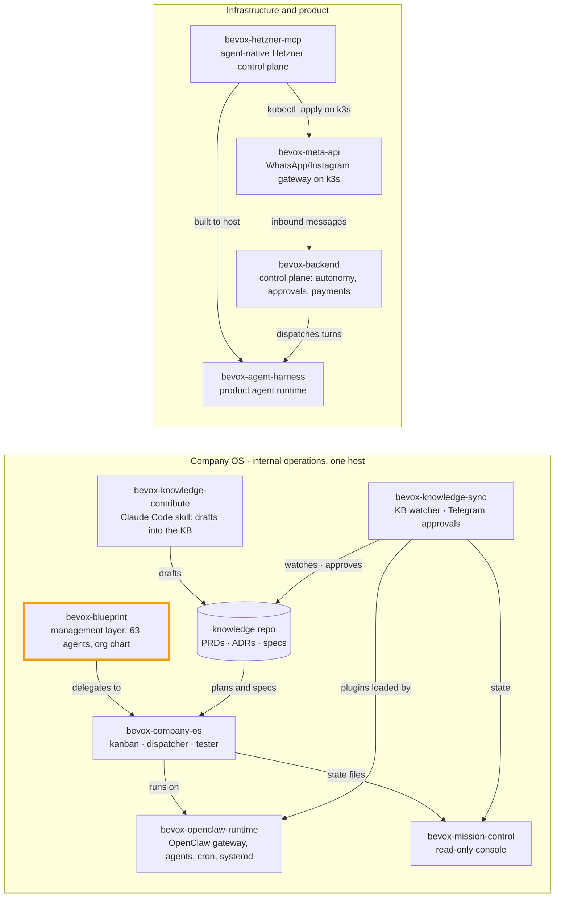

# bevox-blueprint

[](./LICENSE.md)  


> Part of the [4-layer AI-first company series](https://github.com/bernardTavares) ([how the repos fit together](#how-the-repos-fit-together)). License: FSL-1.1-MIT (source-available, converts to MIT after 2 years). Contributors: Henrique Melo de Araújo and Marcus Vinicius.

**The blueprint of an AI-first company: 63 Claude Code agents across 9 departments, plus the org design that makes them coherent.**

Bevox is an AI-first company building an AI secretary for appointment-based small businesses in Brazil. This repo designs it as an *agentic enterprise*: one human, and every department and role a dispatchable Claude Code subagent with a written mission, decision authority, KPIs and reporting lines.

> **Status: blueprint.** Bevox has no paying customers. The org was deliberately designed for the stage it is aiming at ("post-PMF, 10–50 paying customers"), so the role specs talk about real customer load, unit economics and incidents. Read those as the design target, not as traction. The product modules they mention are prototypes. Some, like [bevox-meta-api](https://github.com/bernardTavares/bevox-meta-api), ran in production for internal use only.

## What's inside

| Path | What it is |
|---|---|
| `charter.md`, `strategy.md` | Mission, positioning, business model, and three strategic horizons |
| `org-chart.md` | Mermaid org chart and reporting lines, plus why each role earns its seat at this stage |
| `raci-matrix.md` | R/A/C/I across roles × processes (strategy, hiring, pricing, launches, incidents, compliance, billing) |
| `okrs/` | Corporate OKRs cascaded to each department |
| `processes/` | Hiring, customer success, billing incidents, go-to-market, product strategy, governance |
| `departments/` | 9 departments: engineering, product, design, marketing, sales, customer success, finance, legal, people |
| `.claude/agents/` | **63 dispatchable subagents** (frontmatter with tools and model, plus operating instructions) |
| `docs/agents/` | The human-readable spec for each role (mission, responsibilities, authority, KPIs, RACI handoffs) |
| `.claude/skills/` | Operational skills the agents use: OKR roll-up, cost monitor, Stripe reconciler, WhatsApp health probe, issue-from-feedback, board report |
| `docs/operating-layer.md` | How this management layer maps onto the operating layer that actually builds and runs the software ([bevox-company-os](https://github.com/bernardTavares/bevox-company-os)) |
| `.loop/` | Traces of the autonomous loop that generated this repo: objective, architecture waves, per-mission verify scripts, validation log |

**The agents:**
- **C-suite:** CEO, CTO, CPO, CFO, CMO, COO, CHRO.
- **Department heads.**
- **Individual contributors** sized for the stage:
  - engineering: backend, frontend, mobile, ML/AI, multi-agent systems architect, prompt engineer, incident response, code review, security, DevOps;
  - marketing and sales;
  - finance: FP&A, controller, treasury, AR/AP, tax;
  - design: UX, UI, brand, research, visual storytelling.
- **Scheduled agents:** an OKR digester, a runway monitor, a churn monitor and a competitor sensor.

## Two layers: management and operations

```
          Bernard (the only human)
                   │
   ┌───────────────┴───────────────────┐
   │ Management layer (this repo)      │  decides what and why
   │ CEO · CTO · CPO · CFO · CMO · …   │
   │ Heads · ICs · scheduled agents    │
   └───────────────┬───────────────────┘
                   │ company-os-liaison
   ┌───────────────┴───────────────────┐
   │ Operating layer (bevox-company-os)│  builds and runs the software
   │ dispatcher · tester · clarifier · │  under human-approval governance
   │ knowledge-sync · mission-control  │
   └───────────────────────────────────┘
```

## How it was built

- **The loop.** I started it alone in May 2026 and generated it with an autonomous **claude-loop**. An "architect" turned the objective (`.loop/objective.md`) into waves of missions:
  1. foundation and leadership;
  2. individual contributors per department;
  3. operational skills and integrations;
  4. moving from *building* the blueprint to *operating* the company.

  Each mission ran in its own git worktree and had to pass a generated verify script (`.loop/verify/`) before it was merged.
- **The reference library.** Every role was grounded in a reference library from the loop template (SaaS playbooks, canonical corporate-role templates, agent patterns and specialist archetypes), cited in the role specs. That library is not included here.
- **Contributors.** Two university students, **Henrique Melo de Araújo** and **Marcus Vinicius**, reached out looking for an AI company for a course project. They built a big part of the agents:
  - Henrique: the engineering IC agents (multi-agent systems architect, prompt engineer, incident response, code review, frontend, and the `eng-` wave);
  - Marcus: the marketing agents and their MCP servers, the finance `fin-` agents, and the design department.

  This repo was republished with a fresh history, so their work is credited here.

The docs are in English. The agents' instructions assume Portuguese for customer-facing communication, because Bevox targets Brazilian businesses.

## Using it

Open the repo as a Claude Code project and the agents in `.claude/agents/` become dispatchable subagents. They are written for Bevox (its stack, ICP, LGPD and Pix), so for your own company, treat them as **templates**: replace the company context and keep the structure:
- role → mission → authority → KPIs → handoffs;
- the dual human/agent spec;
- the RACI.

Some agents and skills reference private systems that are not published, such as the knowledge repository (`<org>/bevox-knowledge`) and Stripe/Meta credentials. They describe the integration; they don't include it.

## How the repos fit together

This repo is one piece of Bevox's public code. The repos form two systems: the **Company OS**, which ran Bevox's internal operations on one host on top of OpenClaw, and the **infrastructure** the product was built to run on.



| Repo | Role | Runs with |
|---|---|---|
| [bevox-openclaw-runtime](https://github.com/bernardTavares/bevox-openclaw-runtime) | OpenClaw gateway config, agents (Vox + local Qwen), cron jobs, systemd units | everything in the Company OS runs on it |
| [bevox-company-os](https://github.com/bernardTavares/bevox-company-os) | Supervised agents: plan → kanban → headless Claude Code → tester → Telegram | runtime, mission-control, knowledge-sync |
| [bevox-mission-control](https://github.com/bernardTavares/bevox-mission-control) | Read-only web console over the Company OS state (fork of TenacitOS) | company-os, knowledge-sync |
| [bevox-knowledge-sync](https://github.com/bernardTavares/bevox-knowledge-sync) | Knowledge-repo watcher + OpenClaw plugins for approvals on Telegram | runtime, knowledge-contribute |
| [bevox-knowledge-contribute](https://github.com/bernardTavares/bevox-knowledge-contribute) | Claude Code skill that writes PRDs, ADRs and specs as draft branches | knowledge-sync |
| [bevox-blueprint](https://github.com/bernardTavares/bevox-blueprint) | Management layer: 63 Claude Code agents, org chart, RACI, OKRs | company-os |
| [bevox-hetzner-mcp](https://github.com/bernardTavares/bevox-hetzner-mcp) | MCP server + REST control plane for Hetzner Cloud with an approval gate | built to host the agent harness; manages meta-api's k3s |
| [bevox-meta-api](https://github.com/bernardTavares/bevox-meta-api) | Multi-tenant WhatsApp/Instagram gateway that ran in production on k3s | hetzner-mcp |
| [bevox-agent-harness](https://github.com/bernardTavares/bevox-agent-harness) | The product's agent runtime: per-step reasoning escalation, token-budgeted context, fail-closed permissions, evals, MCP | bevox-backend, hetzner-mcp |
| [bevox-backend](https://github.com/bernardTavares/bevox-backend) | The product's control plane: burst intake, autonomy modes, human approvals, Pix/Stripe payments, calendar | agent-harness, meta-api |

## License

[Functional Source License 1.1, MIT Future License](./LICENSE.md) (FSL-1.1-MIT). Copyright 2026 Bernard Tavares and contributors.

You may use, modify and redistribute it for any purpose except a competing commercial product or service. Each version becomes MIT-licensed two years after its release.
