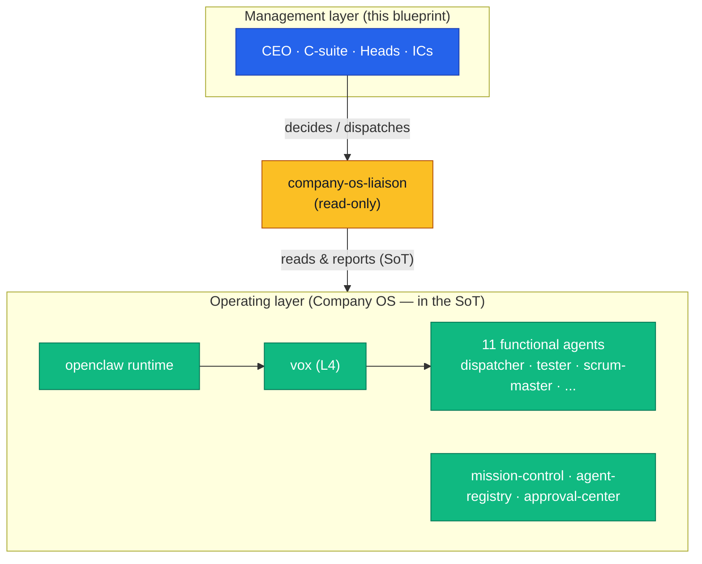

# BEVOX — Org Chart

This is the organizational chart for BEVOX as an agentic enterprise. Every box is a Claude Code agent except the single human at the top. Reporting lines describe how authority and autonomy flow down — not headcount. The org is sized for our actual stage: post-PMF, 10–50 paying customers. There is no enterprise bloat, no "VP of VPs," and no role that only earns its seat at 1,000 customers.

## Reporting graph

```mermaid
graph TD
    Bernard["Bernard Tavares<br/>(Single Human · Owner)"]:::human

    CEO["CEO agent"]:::csuite

    CTO["CTO agent"]:::csuite
    CPO["CPO agent"]:::csuite
    CFO["CFO agent"]:::csuite
    CMO["CMO agent"]:::csuite
    COO["COO agent"]:::csuite
    CHRO["CHRO agent"]:::csuite

    HoEng["Head of Engineering"]:::lead
    HoProd["Head of Product"]:::lead
    HoMkt["Head of Marketing"]:::lead
    HoSales["Head of Sales"]:::lead
    HoCS["Head of Customer Success"]:::lead
    HoFin["Head of Finance"]:::lead
    HoLegal["Head of Legal"]:::lead
    HoPeople["Head of People"]:::lead

    SrBE["Senior Backend Engineer"]:::ic
    MLAI["ML/AI Engineer"]:::ic
    Mobile["Mobile Engineer"]:::ic
    MASA["Multi-Agent Systems Architect"]:::ic
    PE["Prompt Engineer"]:::ic
    IRC["Incident Response Commander"]:::ic
    CR["Code Reviewer"]:::ic
    FE["Frontend Developer"]:::ic
    ProdDesign["Product Designer"]:::ic
    Content["Content Writer"]:::ic
    BDR["BDR"]:::ic
    AE["Account Executive"]:::ic
    Support["Support Specialist"]:::ic
    Billing["Billing Analyst"]:::ic
    Data["Data Analyst"]:::ic

    ContentMgr["Content Manager"]:::lead
    CustomerStory["Customer Story Writer"]:::ic
    LandingPage["Landing Page Agent"]:::ic
    GEO["GEO Agent"]:::ic
    PaidMedia["Paid Media Agent"]:::lead
    AdCreative["Ad Creative Strategist"]:::ic
    CampaignMgr["Campaign Manager"]:::ic
    MktAnalytics["Marketing Analytics"]:::ic
    MarketIntel["Market Intelligence"]:::ic

    FinAnalyst["Financial Analyst"]:::ic
    FPA["FP&A Manager"]:::ic
    TaxStrat["Tax Strategist"]:::ic
    APMgr["Accounts Payable Manager"]:::ic
    ARMgr["Accounts Receivable Manager"]:::ic
    Treasury["Treasury Manager"]:::ic
    FinController["Financial Controller"]:::ic

    UXArch["UX Architect"]:::ic
    UXResearch["UX Researcher"]:::ic
    UIDesign["UI Designer"]:::ic
    BrandGuard["Brand Guardian"]:::ic
    VisualStory["Visual Storyteller"]:::ic
    ImagePrompt["Image Prompt Engineer"]:::ic
    Inclusive["Inclusive Visuals"]:::ic
    PersonaWalk["Persona Walkthrough"]:::ic

    Liaison["Company OS Liaison<br/>(read-only bridge)"]:::bridge

    Bernard --> CEO

    CEO --> CTO
    CEO --> CPO
    CEO --> CFO
    CEO --> CMO
    CEO --> COO
    CEO --> CHRO

    CTO --> HoEng
    CPO --> HoProd
    CMO --> HoMkt
    CMO --> HoSales
    COO --> HoCS
    CFO --> HoFin
    CFO --> HoLegal
    COO -.-> HoLegal
    CHRO --> HoPeople

    HoEng --> SrBE
    HoEng --> MLAI
    HoEng --> Mobile
    HoEng --> Data
    HoEng --> MASA
    CTO -.-> MASA
    HoEng --> PE
    MLAI -.-> PE
    CTO --> IRC
    HoEng --> CR
    HoEng --> FE
    HoProd --> ProdDesign
    HoProd --> UXArch
    HoProd --> UXResearch
    HoProd --> UIDesign
    HoProd --> BrandGuard
    HoProd --> VisualStory
    HoProd --> Inclusive
    HoProd --> PersonaWalk
    VisualStory --> ImagePrompt
    BrandGuard -.-> CMO
    VisualStory -.-> ContentMgr
    UXResearch -.-> MarketIntel
    HoMkt --> ContentMgr
    HoMkt --> PaidMedia
    HoMkt --> MktAnalytics
    HoMkt --> MarketIntel
    HoMkt --> BDR
    ContentMgr --> Content
    ContentMgr --> CustomerStory
    ContentMgr --> LandingPage
    ContentMgr --> GEO
    PaidMedia --> AdCreative
    PaidMedia --> CampaignMgr
    HoSales --> AE
    HoCS --> Support
    HoFin --> Billing
    CFO --> FinAnalyst
    CFO --> FPA
    CFO --> TaxStrat
    CFO --> APMgr
    CFO --> ARMgr
    HoFin --> Treasury
    HoFin --> FinController

    CTO --> Liaison

    classDef human fill:#1f2937,stroke:#111827,color:#ffffff,font-weight:bold;
    classDef csuite fill:#2563eb,stroke:#1e40af,color:#ffffff;
    classDef lead fill:#6366f1,stroke:#4338ca,color:#ffffff;
    classDef ic fill:#e5e7eb,stroke:#9ca3af,color:#111827;
    classDef bridge fill:#fbbf24,stroke:#b45309,color:#111827;
```

> **Legend.** Solid line = primary reporting line. Dotted line = secondary oversight (not dual command). Blue = C-suite agents. Purple = department leads. Grey = IC agents. Head of Legal reports primarily to the CFO (LGPD compliance, contracts, payment-regulation risk all sit close to finance) with a dotted line to the COO (operational/process governance). Solid line from CFO is its accountable manager; the COO dotted line reflects shared oversight, not dual command. Amber = the **Company OS Liaison**, a read-only bridge to the operating layer (see *Operating layer* below and `docs/operating-layer.md`).

## Reporting-line narrative

### Who Bernard talks to

Bernard talks to **one agent: the CEO.** That is the entire point of this structure. Bernard sets direction, approves the rare strategic bet, and trips the structural safeguards (HALTED.md, budget caps, hardened-file deny rules) when needed. He does not dispatch the CTO, debug a Fastify endpoint, or chase a churned account. He delegates intent to the CEO and the CEO decomposes it across the C-suite.

This keeps the human in exactly one loop — strategy and stop-the-world control — and out of every operational loop. If Bernard finds himself talking to a department lead to get something done, the org has failed: that work should have flowed down through the CEO and the relevant C-suite agent.

### How autonomy flows down

Autonomy is delegated, not requested. Each layer holds full execution authority inside its mandate and only escalates upward when a decision crosses a boundary the layer does not own:

1. **Bernard → CEO.** Bernard delegates company intent (the post-PMF goal: get from 10–50 customers to the next leap). The CEO owns translating that into strategy and OKRs and is accountable for the whole company's outcome. The CEO escalates to Bernard only for genuinely strategic forks (major pricing repositioning, a pivot, a large irreversible spend) or to trip a safeguard.

2. **CEO → C-suite.** The CEO assigns each functional outcome to the owning C-suite agent: CTO (the codebase and platform reliability), CPO (what we build and why), CFO (money in/out, unit economics, legal/compliance risk), CMO (demand and revenue generation), COO (the company actually runs day to day — support, delivery, process), CHRO (the agent org itself and the first 1–3 human hires). C-suite agents execute end-to-end without per-step approval. They escalate to the CEO only for cross-functional tradeoffs (e.g. ship-vs-stabilize, spend reallocation across departments).

3. **C-suite → Department leads.** Each C-suite agent delegates concrete operational ownership to its department lead(s). The lead owns the day-to-day mechanics of the function and the IC agents beneath it (added in Phase 2). The lead escalates to its C-suite agent only when a decision changes the function's strategy or its budget envelope.

4. **Department leads → ICs.** Individual-contributor agents (senior backend engineer, ML/AI engineer, mobile engineer, product designer, content writer, BDR, account executive, support specialist, billing analyst, data analyst) execute discrete tasks under their respective department lead. Each IC earns its seat at 10–50 customers — no role exists without load justification. ICs report to a single lead and escalate only when a task crosses departmental boundaries.

The only hard limits on this downward autonomy are structural, not managerial: the HALTED.md kill switch, budget caps, hardened-file deny rules, and the Stop.sh template-remote whitelist. There are no human approval gates on routine execution.

## Why each box is justified at 10–50 customers

Every role on this chart earns its seat at our actual stage. None is aspirational headcount for a company we are not yet running.

| Role | Why it earns its seat at 10–50 customers |
|---|---|
| **CEO** | Someone must own the whole-company outcome and be Bernard's single interface. Without it, Bernard is back in every loop. |
| **CTO** | The product *is* software in production (Fastify + Postgres/pgvector + BullMQ + Stripe Connect + Expo + Next.js + the AI harness). Real customer load means reliability and incident response can't be ad hoc. |
| **CPO** | Post-PMF means imminent pricing/packaging decisions and a real (not assumed) backlog. Product direction needs an owner separate from "build it." |
| **CFO** | Revenue flows through Stripe Connect (subscription + PSP fee split). Unit economics (CAC payback ≤ 3mo, NRR ≥ 110%, gross margin ≥ 70%) are now vital signs, plus LGPD/payment-regulation risk lives here. |
| **CMO** | First repeatable demand generation and the first growth metrics (CAC) need an owner. Marketing + Sales both ladder up here because at this stage GTM is one motion, not two empires. |
| **COO** | The company has to actually run: customer success, delivery, billing operations, and the beginning of process discipline. This is the "does it work day to day" seat. |
| **CHRO** | The org is mostly agents — someone owns the agent roster, role design, and the first 1–3 *human* hires. This is org-design more than HR bureaucracy. |
| **Head of Engineering** | IC engineers exist — the CTO needs operational ownership of delivery/on-call without doing it personally. |
| **Head of Product** | Backlog and discovery execution under the CPO; multiple product surfaces now in flight. |
| **Head of Marketing / Head of Sales** | Funnel is real enough to separate demand creation (Marketing) from closing (Sales) under the CMO. |
| **Head of Customer Success** | NRR ≥ 110% and churn defense need a named owner under the COO as the customer base grows toward 50. |
| **Head of Finance** | Stripe Connect reconciliation, billing-incident handling, and reporting cadence under the CFO. |
| **Head of Legal** | LGPD, terms, PSP/Connect contractual and regulatory exposure — under the CFO with COO process oversight. |
| **Head of People** | Agent-org maintenance and onboarding the first human hires, under the CHRO. |
| **Senior Backend Engineer** | Core Fastify/Postgres/BullMQ platform carries real customer load — needs dedicated build/on-call IC under Head of Engineering. |
| **ML/AI Engineer** | AI secretary (RAG, embeddings, skill engine) is the product differentiator — dedicated IC for model/pipeline work. |
| **Mobile Engineer** | Expo/React Native client is a primary customer touchpoint — needs dedicated IC under Head of Engineering. |
| **Product Designer** | UX for the booking/conversation flow directly drives activation and retention — dedicated IC under Head of Product. |
| **UX Architect** | The design system, tokens, grid, and IA are the foundation every surface and asset conforms to; without one owner, four surfaces (mobile, web, console, site) drift apart — dedicated IC under Head of Product; token/grid changes consult Head of Engineering. |
| **UX Researcher** | Activation depends on removing onboarding friction; evidence-backed personas and journeys (including the AI secretary as a persona) keep design grounded in real behavior, and route marketing-relevant pain to Market Intelligence — dedicated IC under Head of Product. |
| **UI Designer** | Turning foundation + brand into dev-ready, accessible component specs (shadcn/ui web, RN mobile) is a distinct execution load from product-designer's discovery/flow work — dedicated IC under Head of Product. |
| **Brand Guardian** | One owner must protect palette, typography, and the competent-human-secretary voice across every design and marketing asset, with veto power over violations — dedicated horizontal IC under Head of Product, consult line to CMO. |
| **Visual Storyteller** | Instagram-native ICP means feature/result narratives are a continuous production need and the main design↔marketing interface — dedicated IC under Head of Product, dotted line to Content Manager. |
| **Image Prompt Engineer** | Consistent AI-generated imagery across a campaign requires structured prompt engineering, not ad-hoc generation — dedicated IC under Visual Storyteller. |
| **Inclusive Visuals** | Generative models systematically underrepresent Brazil's diversity; a mandatory review gate on every human image protects brand and ethics — dedicated horizontal IC under Head of Product. |
| **Persona Walkthrough** | Simulated deep persona walks catch interface friction pre-ship that analytics only reveals after real users hit it — a cheap early-warning IC under Head of Product, complementary to UX Researcher. |
| **Content Writer** | Demand generation (blog, social, landing pages) requires consistent output — IC under Content Manager (Wave 2). |
| **Content Manager** | Coordinates four content ICs (mkt-content-writer, mkt-customer-story-writer, mkt-landing-page-agent, mkt-geo-agent) and owns the editorial calendar — lead under Head of Marketing. |
| **Customer Story Writer** | Social proof is the gate for paid acquisition; case studies require a dedicated IC to transform customer outcomes into publishable assets — IC under Content Manager. |
| **Landing Page Agent** | Per-vertical landing pages (physio, pilates, aesthetics) are required before any paid campaign activates — dedicated copy IC under Content Manager. |
| **GEO Agent** | Brazilian SMB owners increasingly use LLMs to discover software; absence from those answers leaks the acquisition funnel before it starts — dedicated bi-weekly monitoring IC under Content Manager. |
| **Paid Media Agent** | Paid acquisition requires a lead who enforces the case-study gate, owns campaign structure, and governs the budget ladder — lead under Head of Marketing. |
| **Ad Creative Strategist** | Per-vertical creative with explicit A/B hypotheses is the prerequisite for any spend efficiency learning — IC under Paid Media Agent. |
| **Campaign Manager** | Weekly budget pacing and waste identification within defined thresholds keeps spend efficient between strategic reviews — IC under Paid Media Agent. |
| **Marketing Analytics** | The CMO and Bernard need a single weekly view across content, paid, and intelligence — aggregator IC (not product analytics) under Head of Marketing. |
| **Market Intelligence** | Competitor monitoring (Ninsaúde, iClinic, Doctoralia), vertical search trends, and LLM presence surveillance are ongoing operational needs; expansion signals require structured CEO escalation — IC under Head of Marketing. |
| **BDR** | Outbound prospecting pipeline feeds the sales funnel — IC under Head of Marketing. |
| **Account Executive** | Closing deals from qualified pipeline — IC under Head of Sales. |
| **Support Specialist** | Customer-facing issue resolution and ticket handling — IC under Head of Customer Success. |
| **Billing Analyst** | Stripe Connect reconciliation, invoice disputes, and payment-ops at scale — IC under Head of Finance. |
| **Financial Analyst** | Every spend/investment request needs a decision-ready parecer (scenarios vs. runway, margin, and CAC bars) so the CFO decides fast instead of re-deriving the numbers — IC under CFO. |
| **FP&A Manager** | With real revenue and a real budget, requests need a budget-availability checkpoint and variances need a root cause, not just a delta — IC under CFO. |
| **Tax Strategist** | Brazilian tax regime boundaries (Simples Nacional ceiling, Lucro Presumido) and fiscal credits have material cash impact at this stage; implications must be known before decisions, not after — IC under CFO. |
| **Accounts Payable Manager** | Vendor payments need validation (duplicates, banking-change fraud checks) and timing discipline within terms — the outflow mirror of the Billing Analyst — IC under CFO. |
| **Accounts Receivable Manager** | At 10–50 customers every overdue invoice is material; a standing collections cadence and credit-risk pareceres protect cash without burning relationships — IC under CFO. |
| **Treasury Manager** | Daily cash position, rolling 13-week projection, and per-request cash confirmation feed the Head of Finance's weekly Runway Check with real granularity — IC under Head of Finance. |
| **Financial Controller** | Per-transaction ledger booking with approval-reference verification keeps the book audit-ready between closes, so the monthly close consolidates instead of reconstructing — IC under Head of Finance. |
| **Data Analyst** | Cross-functional metrics, cohort analysis, and reporting — IC under Head of Engineering (data infra). |
| **Multi-Agent Systems Architect** | `bevox-harness` topology, failure modes, HITL gates, and inter-agent context architecture are the core of the AI secretary — dedicated IC under Head of Engineering, dotted line to CTO. |
| **Prompt Engineer** | The AI secretary's output quality depends entirely on prompt quality — dedicated IC for versioning, testing, and hardening harness prompts under Head of Engineering, dotted line to ML/AI Engineer. |
| **Incident Response Commander** | With real customers depending on the AI secretary during business hours, incidents need structured process — severity classification, runbooks, blameless post-mortems, and SLOs. Reports to CTO. |
| **Code Reviewer** | Last quality gate before production — reviews all PRs for correctness, LGPD compliance, security (injection, auth bypass, cross-tenant leakage), and test coverage across all eight Bevox modules. |
| **Frontend Developer** | Owns bevox-web (Next.js 14 customer portal), bevox-console (internal backoffice), and bevox-site (marketing site) — the web surfaces where professionals configure their AI secretary. |

What is **deliberately absent**: regional VPs, a separate Chief Revenue Officer layered over the CMO, a CISO org, a dedicated Chief of Staff, or any "VP of VPs" tier. Those earn their seats at hundreds-to-thousands of customers, not at 10–50. We add the layer when the load demands it, not before — consistent with stage-honest org evolution where structure trails customer count, never leads it.

## Operating layer (Company OS / OpenClaw)

The org above is the **management layer** — business/decision personas. It is one half of a
**dual-layer** model. The other half is the **operating layer**: the real Company OS that builds and
runs the product, which lives in the canonical source of truth (`bevox-knowledge`), not invented
here. Full detail in `docs/operating-layer.md`; read the live truth with the `bevox-knowledge-read`
skill.

- **Runtime:** `openclaw` (gateway, sessions, agents, kanban, runners).
- **Principal agent:** `vox` (L4) orchestrates daily ops.
- **Functional agents (12 total):** `vox` + dispatcher, tester, scrum-master, clarification,
  delivery, delivery-status, documentation, github-admin, infra, product, agent-creator — under
  L1–L4 governance (ADR-003).
- **Surfaces:** `mission-control` (read-only exec UI), `agent-registry`, `approval-center`.

**The bridge — `company-os-liaison`.** A read-only blueprint agent (reports to the CTO, serves all
personas) that queries the SoT and reports the real registry, capabilities, and delivery status, so
the management personas plan against reality. It writes nothing canonical. See
`docs/agents/company-os-liaison.md`.

---

*Grounding:* reporting structure and role roster follow the company README ground truth and `charter.md` (Operating Principle: single human + full-autonomy agents; post-PMF 10–50-customer stage; no enterprise bloat). Org-by-stage ordering and the no-premature-layering principle follow `references/corporate-roles/INDEX.md` (canonical C-suite + head-of-* role set) and `references/industry-playbooks/saas-b2b.md:26-29` (org structure and the order in which roles are added by stage).
